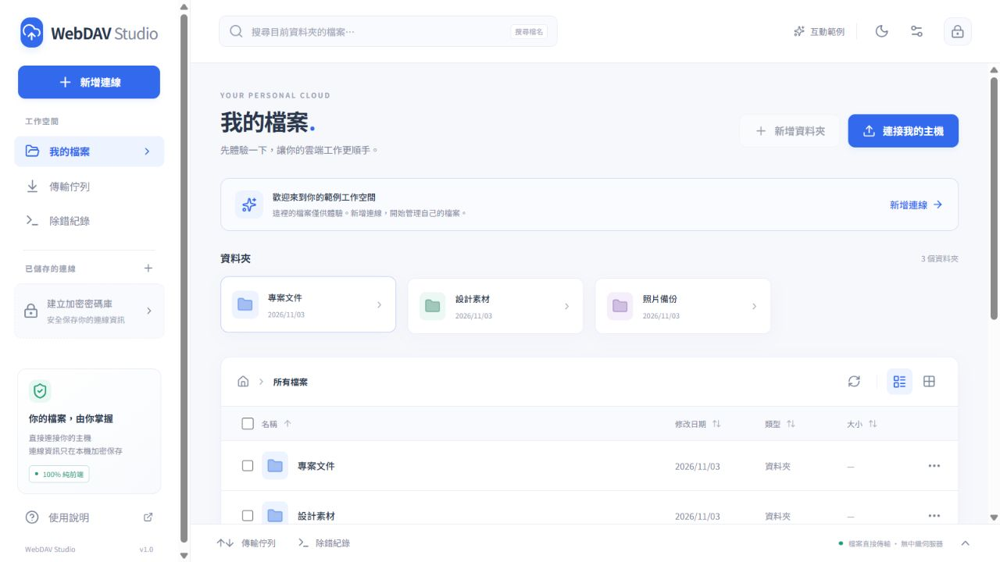

# WebDAV Studio

一個漂亮、私密的純前端 WebDAV 工作空間。像使用雲端硬碟一樣整理自己的檔案，並在需要時查看每一次請求的除錯紀錄。

**React · TypeScript · Vite · GitHub Pages · MIT**

[開啟線上工具](https://root50643.github.io/webdav-studio/) · [GitHub 專案](https://github.com/root50643/webdav-studio)



## 功能

- 繁體中文、淺色／深色主題、響應式介面與唯讀互動範例。
- 多主機管理，支援 Basic Authentication 或匿名連線。
- 清單／網格、資料夾導覽、目前資料夾名稱搜尋、欄位排序。
- 拖放多檔上傳、單檔下載、圖片／純文字預覽。
- 新增資料夾、重新命名、同主機移動／複製、多選永久刪除。
- 傳輸佇列、位元組進度、取消與手動重試；覆寫前確認。
- 主密碼加密的本機連線密碼庫、鎖定與主密碼變更。
- 可篩選、搜尋、展開、複製及匯出 JSON 的除錯紀錄。

網站完全由靜態檔案組成。正式使用時，檔案與 WebDAV 憑證只從你的瀏覽器傳到你設定的 WebDAV 主機；不經由本專案的中繼伺服器。沒有分析追蹤、遠端字型或第三方 CDN。

## 本機開發

建議使用 Node.js 24 LTS，並依 `package.json` 的 `packageManager` 安裝 pnpm。

```sh
npm install --global pnpm@11.25.0
pnpm install
pnpm dev
```

開啟終端機顯示的網址，通常是 <http://127.0.0.1:5173/>。請透過開發伺服器開啟，勿直接以 `file://` 開啟 `index.html`。

```sh
pnpm typecheck   # TypeScript 型別檢查
pnpm test        # 單元與實際 HTTP WebDAV 整合測試
pnpm build       # 產生 dist/
pnpm preview     # 預覽正式建置
pnpm preview:pages # 在 /pages-check/ 子路徑以嚴格靜態伺服器驗證 Pages 資源載入
```

### 沒有 WebDAV 主機也能試用

首頁的「瀏覽互動範例」不需要帳號，也不會連線外部主機。若要測試真實讀寫，可另外啟動僅供開發使用的記憶體測試主機：

```sh
pnpm fixture
```

新增連線時使用下列**公開的測試資料**：

| 欄位        | 測試值                       |
| ----------- | ---------------------------- |
| WebDAV 網址 | `http://127.0.0.1:1900/dav/` |
| 帳號        | `demo`                       |
| 密碼        | `studio-test`                |

測試主機只綁定 `127.0.0.1`，資料只在記憶體中，重啟即重設。上傳上限 32 MiB，預設允許本機 5173／4173 來源。請使用本機 HTTP 開發頁面連線，不要從 HTTPS GitHub Pages 連這個 HTTP fixture。測試主機不會進入正式建置。

## 使用方式

1. 點選「新增連線」，首次使用先建立至少 8 個字元的主密碼。
2. 填入連線名稱、完整 WebDAV 資料夾網址、驗證方式與逾時秒數。
3. 可先「測試連線」，再「儲存並連線」。成功保存後，才會顯示已儲存。
4. 點擊資料夾瀏覽；檔案可預覽或從操作選單下載。搜尋只篩選目前資料夾，並非全主機搜尋。
5. 拖放檔案或點擊「上傳檔案」。同名檔案會詢問是否覆寫；主機端另外使用 `If-None-Match: *` 防止未確認的覆寫。
6. 勾選檔案後可移動、複製或刪除。移動與複製預設 `Overwrite: F`；永久刪除沒有回收筒。
7. 展開底部「傳輸佇列」或「除錯紀錄」查看進度與錯誤。切換連線或鎖定會取消現有請求與傳輸。

重新開啟頁面後，必須以主密碼解鎖才能顯示已保存的主機。網址片段只包含連線的隨機識別碼與檔案路徑，不包含主機帳號密碼。檔名／路徑可能出現在瀏覽器歷史或匯出紀錄中，分享前請自行檢查。

## 部署到 GitHub Pages

1. 在 GitHub 建立 repository，將本專案推送至 `main`。
2. 在 repository 的 **Settings → Pages → Build and deployment → Source** 選擇 **GitHub Actions**。
3. 推送 `main` 或手動執行 **Deploy to GitHub Pages** workflow。
4. workflow 完成後，開啟部署頁面顯示的網站網址。

專案採用相對資源路徑（Vite `base: './'`）與 hash 導覽。適用於 `https://OWNER.github.io/REPO/`、帳號根網站與自訂網域；不需要為更改 repository 名稱修改程式碼。重新整理檔案資料夾不需要額外 404 重寫。

PR 會執行型別檢查、測試與建置；部署 workflow 也會先完成相同檢查。使用同一份 lockfile 安裝。沒有需要上傳的 WebDAV 帳號密碼，也不應為本網站設定任何前端憑證環境變數。

`pnpm build` 後，可執行 `pnpm preview:pages` 並開啟 <http://127.0.0.1:4173/pages-check/>。這個開發工具使用沒有 SPA fallback 的靜態伺服器，便於確認 repository 子路徑、資源與 hash 重新整理確實可用。

## WebDAV 主機與 CORS

GitHub Pages 只提供網站的靜態檔案。**WebDAV 主機需要有效 HTTPS 憑證，並允許你的網站來源執行跨來源請求。** 瀏覽器無法從前端程式繞過 CORS、無效憑證或 HTTPS 頁面中的 HTTP 連線限制。

例如網站網址是 `https://alice.github.io/webdav-studio/`，CORS origin 是 **`https://alice.github.io`**，不包含 repository 路徑。自訂網域則填寫該網域的 origin。

使用本專案的線上工具時，請允許 **`https://root50643.github.io`**。

主機／反向代理應提供：

- `Access-Control-Allow-Origin`：明確允許的網站 origin。
- `Access-Control-Allow-Methods`：`OPTIONS, PROPFIND, GET, HEAD, PUT, MKCOL, MOVE, COPY, DELETE`。
- `Access-Control-Allow-Headers`：`Authorization, Content-Type, Depth, Destination, Overwrite, If-None-Match, If-Match`。
- `Access-Control-Expose-Headers`：`DAV, Allow, ETag, Content-Length, Content-Type, Last-Modified, Retry-After, X-Request-ID`，讓診斷能讀取這些值。
- OPTIONS 預檢不要求登入；401／403／404／5xx 等錯誤回應也必須帶有 CORS 標頭。

參考 [Nginx 設定範例](docs/nginx-cors.conf.example)。這個範例代理到**已存在的 WebDAV 服務**，Nginx 標準 DAV 模組本身不提供完整的 PROPFIND 功能。依主機實際網址調整 upstream 與路徑，避免重複 CORS 標頭。若 NAS 預設服務無法調整 CORS，可使用自己控制的 HTTPS 反向代理；網站本身仍為純前端。

客戶端使用明確的 Authorization 標頭，省略跨來源 Cookie；不支援需要瀏覽器 Cookie 登入、Digest、NTLM 或特殊 OAuth 流程的主機。WebDAV 根目錄應直接回傳資料，而非 HTML 登入頁或重新導向；Fetch 請求會拒絕重新導向。

## 密碼庫與隱私

- 整組主機設定以 **AES-256-GCM** 加密，再寫入 IndexedDB。
- 以 **PBKDF2-SHA-256、600,000 次迭代、16-byte 隨機 salt** 衍生不可匯出的金鑰。
- 每次保存使用新的 **12-byte 隨機 IV**；密文含格式版本、salt 與衍生參數，且使用版本識別的 authenticated additional data。
- 主密碼與解密金鑰不寫入 localStorage、IndexedDB、網址或紀錄；只在開啟中的頁面記憶體使用。
- 變更主密碼時先驗證目前密碼，再重新加密；只有 IndexedDB 交易完成才更新目前狀態。保存失敗會明確顯示。
- 資料按網站來源與部署路徑分開保存。更換網域、瀏覽器、無痕視窗或清除網站資料後，無法沿用原密碼庫。
- 本版沒有備份、同步或密碼復原功能。忘記主密碼只能清除本機密碼庫重建，不影響主機上的檔案。
- localStorage 僅儲存主題與清單／網格偏好。請只在信任的瀏覽器與網站版本中輸入憑證；本機靜態加密不防護已解鎖頁面的惡意程式或惡意瀏覽器擴充套件。

## 除錯紀錄與常見問題

記錄包含操作、時間、方法、清理後的 URL、HTTP 狀態、耗時、允許顯示的回應標頭，以及最多 4096 字元的錯誤內容。成功的下載／上傳內容不會寫入紀錄。密碼、Basic token、Authorization、Cookie 與 URL 查詢參數會移除或遮蔽。匯出與複製共用畫面使用的同一份清理後資料。

只在頁面記憶體保留最近 500 筆，重新整理會清除。匯出仍可能包含主機名稱與檔案名稱，請在分享前檢查。

| 情況                            | 檢查方向                                                                                                       |
| ------------------------------- | -------------------------------------------------------------------------------------------------------------- |
| 無 HTTP 狀態碼、Failed to fetch | 開啟瀏覽器 Console／Network；可能是網路、DNS、CORS、憑證、重新導向或瀏覽器區網限制，程式無法確定被隱藏的原因。 |
| 401                             | 確認帳密、驗證方式與 WebDAV 路徑；若畫面只有網路錯誤，檢查 401 是否帶有 CORS 標頭。                            |
| 403                             | 確認讀寫權限與主機端存取規則。                                                                                 |
| 405／回傳 HTML                  | 確認是 WebDAV 服務端點，並檢查反向代理是否允許該方法。OPTIONS 不支援不會否定已成功的 PROPFIND。                |
| 409／412                        | 目標不存在、同名衝突或條件式寫入遭拒；預設不會自動覆寫。                                                       |
| 423／507                        | 檔案被鎖定／主機儲存空間不足。                                                                                 |
| 207 但操作失敗                  | Multi-Status 內含部分項目失敗；檢查展開的紀錄並重新整理。多項操作不具有跨檔案交易保證。                        |
| 傳輸取消／網路中斷              | 伺服器可能已收到部分或全部內容。重新整理確認後再重試；本工具無法回滾主機已接受的寫入。                         |
| 沒有百分比                      | 主機未提供可讀取的 Content-Length，仍會顯示已傳輸位元組。                                                      |
| 無法使用本機密碼庫              | 確認允許 IndexedDB、有足夠空間，並使用 HTTPS 或 localhost。                                                    |

## 相容性與第一版範圍

使用現代 Chrome、Edge、Firefox 或 Safari。Chrome／Edge 支援時，可在使用者選擇目的檔案後串流寫入磁碟；其他瀏覽器或不支援該 API 的嵌入式環境會使用 Blob 下載。Blob 單次上限 **256 MiB**，包含無 Content-Length 的回應也會在串流讀取時檢查上限，不會無限制累積記憶體。手機可用記憶體較少，建議使用較小的檔案。

圖片預覽限 **20 MiB**；純文字預覽限 **1 MiB**。HTML、SVG、XHTML 與 XML 不做內嵌預覽。預覽關閉會取消讀取並釋放物件網址。

不含整個資料夾上傳、資料夾 ZIP 下載、斷點續傳、跨主機移動／複製、分享連結、回收筒與遠端協作。移動、複製、鎖定與特殊路徑支援仍依主機的 WebDAV 實作與權限而定。

## 專案結構

```text
src/
  components/        對話框、預覽、目的資料夾與活動面板
  lib/               WebDAV、路徑、密碼庫、傳輸、紀錄與測試
  App.tsx            工作空間與使用者操作流程
  styles.css         響應式主題與元件樣式
scripts/             僅供開發的記憶體 WebDAV fixture
docs/                CORS 設定範例
.github/workflows/   CI 與 Pages 部署
```

本專案依 [MIT License](LICENSE) 授權。
